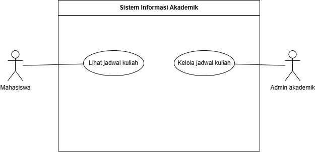

  <h2>📑 Laporan Use Case Diagram - Pertemuan 2</h2>
  
<b>Muhammad Thoriq Mustaqim</b> | NIM: 2406045

  

### 🎯 A. Justifikasi Aktor dan Use Case
Berdasarkan dokumen konteks bisnis, sistem ini memiliki batasan ruang lingkup (*In-Scope*) yang jelas. Berikut adalah pemetaan aktor dan *use case*:

| Aktor | Peran / Interaksi dengan Sistem |
| :--- | :--- |
| **Mahasiswa** | Aktor utama. Berinteraksi langsung untuk melakukan autentikasi dan mengajukan peminjaman. |
| **Laboran** | Aktor utama. Berinteraksi langsung untuk memvalidasi peminjaman, mencatat pengembalian, dan melihat laporan. |
| **Dosen PJ & Pengelola Lab** | *Stakeholder* (Bukan aktor). Memiliki kepentingan terhadap laporan dan akuntabilitas aset, namun tidak berinteraksi langsung dengan sistem perangkat lunak pada tahap ini. |

> *Catatan: Sesuai materi, aktor adalah pihak yang berinteraksi langsung dengan sistem. Oleh karena itu, Dosen PJ dan Pengelola Lab tidak digambarkan sebagai *stick figure* di diagram.*

### 🖼️ B. Diagram Use Case
 

### 🛠️ C. Catatan Perbaikan Notasi (Review)
Sesuai Tujuan Pembelajaran ke-5, berikut adalah catatan perbaikan saat proses *review* mandiri:
1.  **Kesalahan Awal:** Awalnya saya menempatkan aktor "Dosen PJ" di sisi kiri dan menarik garis asosiasi ke *Use Case* "Melihat Laporan".
2.  **Koreksi:** Berdasarkan teori, Dosen PJ adalah *stakeholder* yang tidak menggunakan sistem secara langsung. Garis asosiasi dihapus, dan aktor dihilangkan dari diagram agar notasi UML valid. Hak akses laporan dialihkan ke aktor yang berinteraksi langsung (Laboran/Pengelola).
3.  **Perbaikan Garis:** Memastikan garis asosiasi tidak memiliki panah (karena asosiasi bersifat dua arah pada Use Case Diagram) dan tidak ada garis yang saling bersilangan agar mudah dibaca.
